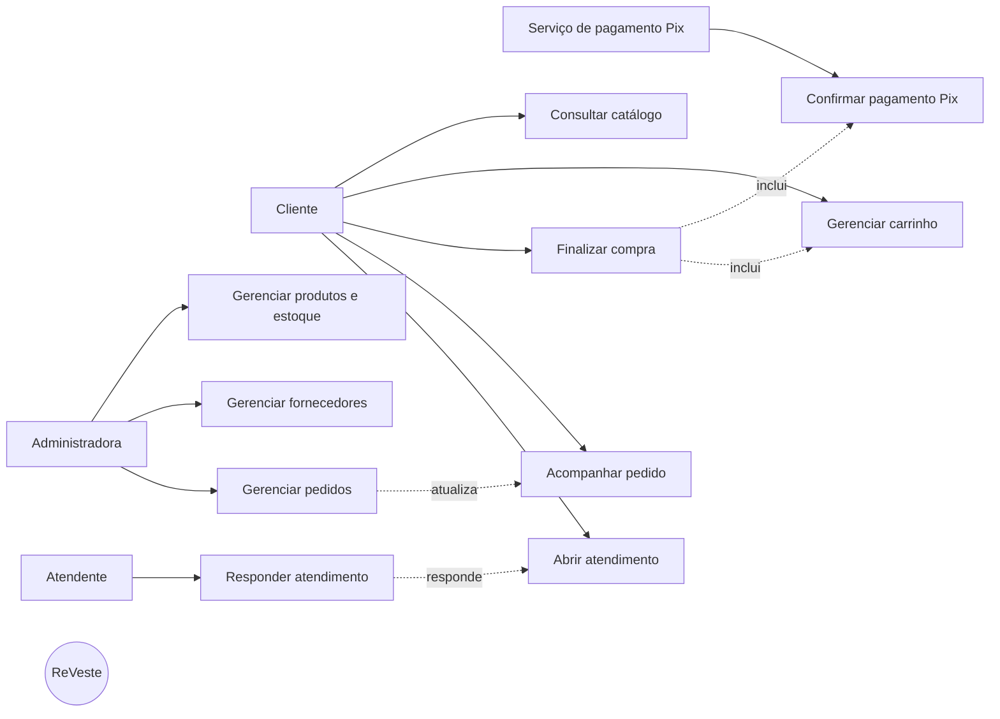
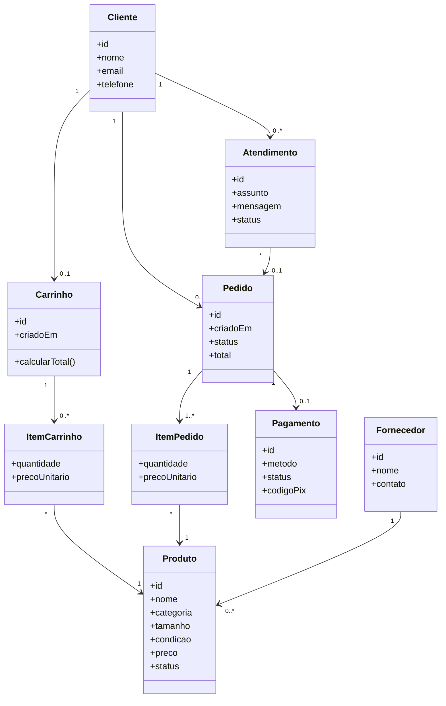
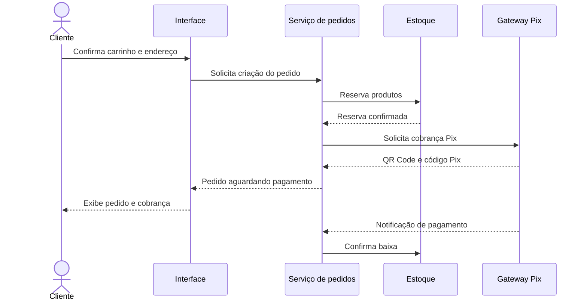
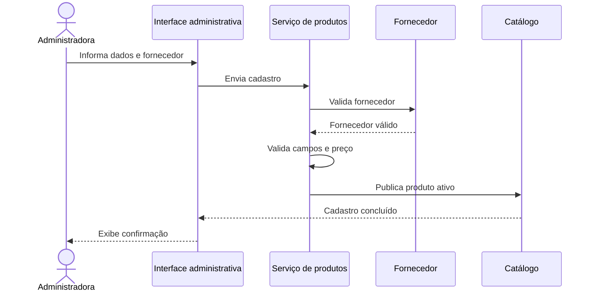
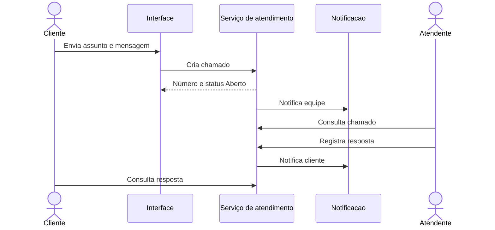
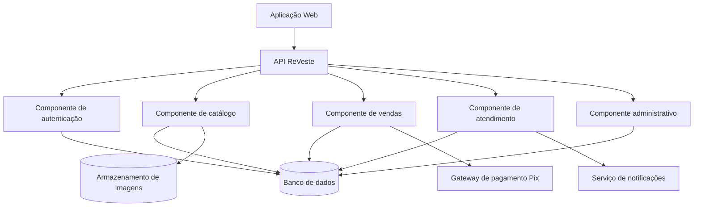
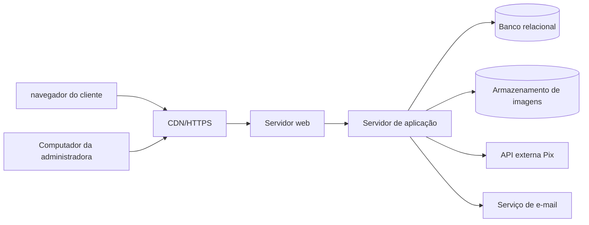

# ReVeste: plataforma de brechó para economia circular

**Disciplina:** Análise e Projeto de Sistemas  
**Projeto:** Sistema de comércio eletrônico para roupas e calçados usados  
**Data:** 20 de novembro de 2026

## 1. Resumo

Este artigo apresenta a análise e o projeto do ReVeste, uma plataforma digital
para venda de roupas e calçados usados. A solução permite que clientes
consultem um catálogo, realizem pedidos e paguem inicialmente por Pix, enquanto
a administradora cadastra produtos, gerencia fornecedores e acompanha pedidos.
O sistema busca ampliar a reutilização de peças, reduzir o descarte de tecidos
e incentivar a economia circular.

**Palavras-chave:** brechó online; economia circular; UML; MVP; sustentabilidade.

## 2. Visão do produto

### 2.1 Problema

Lúcia deseja comercializar roupas e calçados usados pela internet, mas não
possui uma solução para expor o catálogo, receber pagamentos, controlar
fornecedores e prestar atendimento aos clientes.

### 2.2 Visão

O ReVeste será uma plataforma web responsiva que conecta consumidores a peças
de segunda mão, oferecendo uma experiência simples de descoberta, compra e
acompanhamento. O sistema também dará à administradora informações para
controlar estoque, fornecedores e impacto ambiental.

### 2.3 Objetivos

- Disponibilizar catálogo pesquisável com fotos, medidas, estado e preço.
- Permitir compra com pagamento por Pix no primeiro MVP.
- Controlar produtos, estoque, pedidos e fornecedores.
- Oferecer canal de atendimento ao cliente.
- Comunicar o impacto positivo da reutilização das peças.

### 2.4 Escopo do primeiro MVP

**Incluído:** cadastro e consulta de produtos, carrinho, criação de pedido,
pagamento por Pix, acompanhamento de status, gestão de fornecedores e
atendimento básico.

**Fora do MVP:** pagamento por boleto e cartão, aplicativo nativo, logística
integrada, recomendações por inteligência artificial e marketplace aberto para
qualquer vendedor.

### 2.5 Atores

| Ator | Responsabilidade |
|---|---|
| Cliente | Consulta produtos, compra, paga e acompanha pedidos |
| Administradora | Gerencia produtos, estoque, fornecedores e pedidos |
| Atendente | Responde solicitações e atualiza chamados |
| Serviço de pagamento | Gera e confirma cobranças Pix |

## 3. Diagrama de casos de uso

O diagrama contém dez casos de uso; os seis casos priorizados para o MVP são
UC1 a UC6.

## 4. Casos de uso do MVP

### UC1 — Consultar catálogo

**Ator principal:** Cliente.  
**Pré-condição:** O catálogo está disponível.  
**Fluxo principal:** o cliente acessa o catálogo, informa filtros opcionais,
visualiza os produtos disponíveis e abre os detalhes de uma peça.  
**Exceção:** se não houver resultados, o sistema informa a situação e permite
alterar os filtros.  
**Pós-condição:** os produtos compatíveis são apresentados.

**História:** Como cliente, quero pesquisar e filtrar peças para encontrar
rapidamente um produto adequado ao meu interesse.

**Critérios de aceitação:**

1. Dado um catálogo disponível, quando o cliente acessa a página, então o
   sistema exibe apenas produtos ativos e disponíveis.
2. Quando o cliente informa categoria, tamanho ou faixa de preço, então o
   sistema retorna somente itens compatíveis com os filtros.
3. Quando não houver resultados, então o sistema exibe uma mensagem orientativa.

### UC2 — Gerenciar carrinho

**Ator principal:** Cliente.  
**Pré-condição:** O produto está disponível.  
**Fluxo principal:** o cliente escolhe uma peça, adiciona-a ao carrinho,
confere os itens e altera ou remove itens. Como cada peça usada é única, a
quantidade máxima de um produto é um.

**História:** Como cliente, quero montar um carrinho para revisar minha compra
antes de finalizar o pedido.

**Critérios de aceitação:**

1. O sistema não permite adicionar ao carrinho um produto indisponível.
2. O carrinho mostra produto, preço, subtotal e total.
3. Ao remover um item, o total é recalculado imediatamente.

### UC3 — Finalizar compra

**Ator principal:** Cliente.  
**Pré-condição:** O carrinho possui ao menos um item.  
**Fluxo principal:** o cliente informa seus dados e endereço, confirma o
resumo, seleciona Pix e cria o pedido. O sistema reserva o estoque e solicita
uma cobrança Pix.

**História:** Como cliente, quero finalizar minha compra por Pix para receber
as instruções de pagamento e garantir a reserva da peça.

**Critérios de aceitação:**

1. O sistema exige os dados obrigatórios antes de criar o pedido.
2. O pedido criado recebe identificador e status `Aguardando pagamento`.
3. O cliente visualiza QR Code ou código Pix e o valor exato da cobrança.
4. Se a geração da cobrança falhar, o sistema informa o erro e não confirma o
   pedido como pago.

### UC4 — Acompanhar pedido

**Ator principal:** Cliente.  
**Pré-condição:** O cliente possui um pedido.  
**Fluxo principal:** o cliente acessa seus pedidos e visualiza itens, valor,
pagamento e status de processamento, envio ou conclusão.

**História:** Como cliente, quero acompanhar o status do pedido para saber o
que já aconteceu e o que ainda falta para recebê-lo.

**Critérios de aceitação:**

1. O cliente visualiza somente seus próprios pedidos.
2. Cada pedido exibe identificador, data, itens, total e status atual.
3. O status apresentado corresponde à última atualização registrada.

### UC5 — Gerenciar produtos e estoque

**Ator principal:** Administradora.  
**Pré-condição:** A administradora está autenticada.  
**Fluxo principal:** a administradora cadastra, edita, desativa produtos e
atualiza estoque, incluindo fotos, categoria, tamanho, condição e preço.

**História:** Como administradora, quero cadastrar e controlar peças para manter
o catálogo confiável e evitar venda de produtos indisponíveis.

**Critérios de aceitação:**

1. O cadastro exige nome, categoria, tamanho, condição e preço válido.
2. Um produto sem estoque não aparece como disponível para compra.
3. A administradora consegue desativar um anúncio sem apagar seu histórico.

### UC6 — Abrir atendimento

**Ator principal:** Cliente.  
**Pré-condição:** O cliente está identificado.  
**Fluxo principal:** o cliente informa assunto e mensagem, podendo relacionar
o chamado a um pedido. O sistema cria o chamado com status `Aberto`.

**História:** Como cliente, quero abrir um chamado para esclarecer dúvidas ou
resolver problemas relacionados à minha compra.

**Critérios de aceitação:**

1. O sistema exige assunto e mensagem não vazios.
2. O chamado recebe número, data e status inicial `Aberto`.
3. O cliente consegue consultar as respostas do atendente.

## 5. Diagrama de classes conceitual

## 6. Diagramas de sequência

### 6.1 Finalização de compra com Pix

### 6.2 Cadastro de produto

### 6.3 Atendimento ao cliente

## 7. Diagrama de componentes

## 8. Diagrama de implantação

O navegador e o computador administrativo são nós de apresentação. O servidor
web termina HTTPS e encaminha as requisições para o servidor de aplicação. O
servidor de aplicação acessa o banco e o armazenamento privado, além de
integrar-se aos serviços externos por HTTPS. Credenciais e chaves de
integração não devem ser armazenadas no código-fonte.

## 9. Padrões de projeto

Como o material fornecido menciona a necessidade de pesquisar um padrão, mas
não lista um nome específico, foram selecionados padrões compatíveis com a
arquitetura do ReVeste. Eles podem ser substituídos pelo padrão formalmente
indicado pela professora sem alterar os demais artefatos.

### 9.1 MVC — arquitetura da aplicação

O **Model** representa Cliente, Produto, Pedido e demais entidades; a **View**
apresenta catálogo e pedidos; o **Controller** recebe ações da interface e
coordena os serviços. A separação reduz acoplamento e facilita testes e
manutenção. O padrão é adequado porque o sistema possui múltiplas telas e
fluxos de usuário.

### 9.2 Repository — acesso a dados

Interfaces como `ProdutoRepository` e `PedidoRepository` isolam os serviços da
tecnologia do banco. Assim, o serviço de vendas não precisa conhecer SQL ou
detalhes de persistência, e os testes podem utilizar repositórios em memória.

### 9.3 Strategy — formas de pagamento

Uma interface `EstrategiaPagamento` pode definir `criarCobranca` e
`consultarStatus`. `PagamentoPixStrategy` implementa o MVP; futuramente,
`PagamentoCartaoStrategy` e `PagamentoBoletoStrategy` poderão ser adicionadas
sem alterar o caso de uso de finalização. O padrão evita condicionais
espalhadas por todo o sistema.

### 9.4 Observer — atualizações e notificações

Eventos como `PagamentoConfirmado`, `PedidoAtualizado` e
`ChamadoRespondido` podem notificar e-mail, painel administrativo e histórico.
O pedido não precisa conhecer cada canal de notificação, reduzindo dependências.

### 9.5 Factory Method — criação de integrações

Uma fábrica pode criar o gateway de pagamento conforme a configuração da
aplicação. Isso concentra a escolha da implementação e facilita trocar o
provedor Pix em testes ou em produção.

## 10. Requisitos não funcionais e riscos

- **Segurança:** autenticação, autorização por perfil, HTTPS e proteção de
  dados pessoais.
- **Disponibilidade:** pedidos devem manter histórico mesmo se a notificação
  falhar.
- **Usabilidade:** catálogo responsivo e mensagens de erro compreensíveis.
- **Integridade:** reserva de estoque deve ser transacional para impedir venda
  duplicada da mesma peça.
- **Privacidade:** coletar apenas os dados necessários e definir política de
  retenção.

Principais riscos: indisponibilidade do gateway Pix, inconsistência de estoque,
fraudes em pagamentos, imagens inadequadas e dificuldade de adesão de clientes.
Mitigações incluem confirmação por webhook, transações, validação do gateway,
moderação de conteúdo e monitoramento.

## 11. Conclusão

O ReVeste atende ao problema apresentado ao organizar catálogo, venda,
pagamento, estoque, fornecedores e atendimento em uma solução única. O MVP
prioriza valor para o cliente e para a administradora, mantendo pontos de
extensão para novos meios de pagamento, logística e recursos de
sustentabilidade. Os diagramas UML e os padrões escolhidos fornecem uma base
coerente para a implementação incremental.

## 12. Declaração de uso de inteligência artificial

Foi utilizada inteligência artificial como apoio à organização dos requisitos,
redação inicial e elaboração dos diagramas deste artigo, em 20 de novembro de
2026. O conteúdo deve ser revisado e validado pelos integrantes do grupo antes
da entrega, conforme as normas institucionais do CEUB.

## 13. Referências

CEUB. **01_2 APS — Introdução à Análise e Projeto de Sistemas**. Material
didático da disciplina. Arquivo fornecido pelo professor, 2025.

SOMMERVILLE, Ian. **Engenharia de software**. 10. ed. São Paulo: Pearson,
2019. Referência para processos de desenvolvimento e modelos de ciclo de vida.

PRESSMAN, Roger S.; MAXIM, Bruce R. **Engenharia de software: uma abordagem
profissional**. 9. ed. Porto Alegre: AMGH, 2021. Referência para processos,
requisitos e qualidade de software.

OBJECT MANAGEMENT GROUP. **OMG Unified Modeling Language (OMG UML), version
2.5.1**. 2017. Disponível em:
<https://www.omg.org/spec/UML/2.5.1/>. Acesso em: 20 nov. 2026.

BECK, Kent et al. **Manifesto para Desenvolvimento Ágil de Software**. 2001.
Disponível em: <https://agilemanifesto.org/iso/ptbr/manifesto.html>. Acesso
em: 20 nov. 2026.

GAMMA, Erich et al. **Design patterns: elements of reusable
object-oriented software**. Boston: Addison-Wesley, 1994. Referência para os
padrões Strategy, Repository, Observer, Factory Method e MVC.
